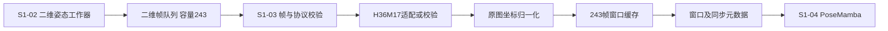
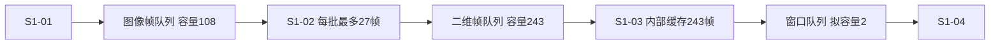
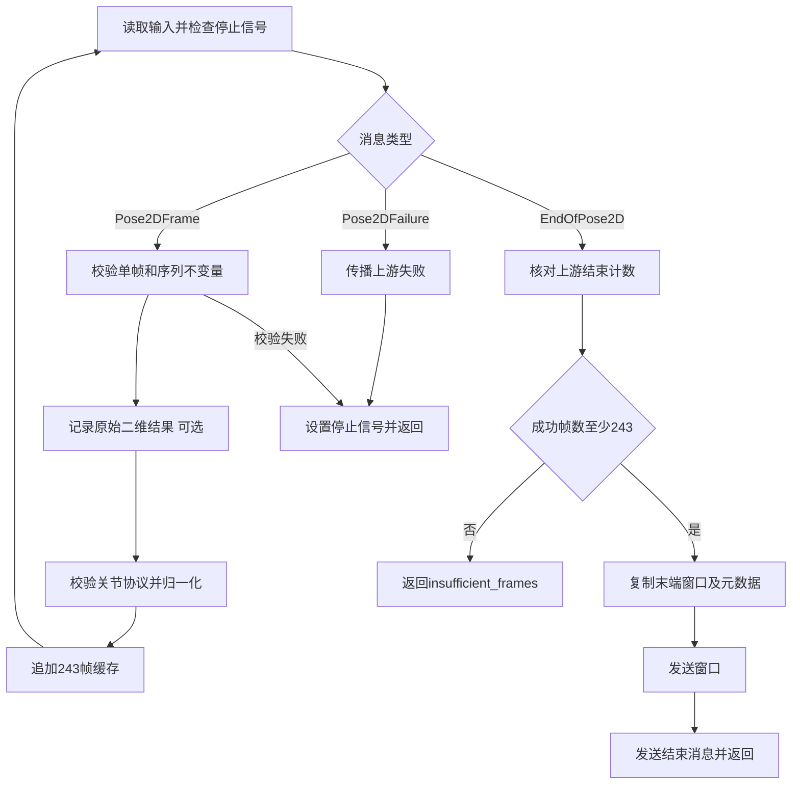

# S1-03 骨架与时序适配详细设计

> 状态：设计稿，S1-03 尚未实现；本文中的新数据类型、配置、命令和测试均为拟实现接口。
> 日期：2026-10-10。
> 上游：S1-02 单人检测与二维关节定位。
> 下游：S1-04 PoseMamba 三维时序提升。
> 当前决策：基准直接使用 243 帧窗口；S1-02 输出队列容量为 243。

## 1. 文档目的

S1-03 将逐帧二维姿态转换为可交给 PoseMamba 的时间窗口：检查帧和关节协议，将原图像素坐标归一化，积累 243 帧，并同步输出帧号、时间戳和质量元数据。

本文沿用 S1-01、S1-02 的模块设计方式，明确数据接口、队列与缓存、处理步骤、异常处理和验收要求。只新增本模块设计，不把拟实现能力写成已完成能力。

本次采用以下决策：

- 当前二维模型为 `rtmpose_l_h36m`，输出已核对的 H36M17 顺序，关节轴原样保留。
- 基准窗口长度为 243，不实施 81 帧窗口基准。
- 基准模式只输出截止时刻前的末端单窗口，不进行滑窗融合。
- 后续完整序列模式仍使用 243 帧窗口，拟采用 81 帧推理步长；81 表示移动距离。
- S1-02 至 S1-03 的输入队列容量为 243；S1-03 自身另有最多 243 帧的时间窗口缓存。
- 基准按项目 50 FPS 时间轴进行严格校验，不静默复制、插值或修改时间戳。

旧阶段一总方案中仍有“81 帧基准”和“二维输出队列 108”的描述。本文按本次确定的 243 帧基准和实际本地配置设计；旧文档尚未整体同步。

## 2. 模块边界



S1-03 负责：

- 消费 `Pose2DFrame`、`EndOfPose2D` 和 `Pose2DFailure`。
- 检查单序列约束、帧顺序、图像尺寸、模型身份和时间间隔。
- 检查 H36M17 输入协议；当前已核查模型采用 identity 映射。
- 将原图像素坐标转换为正式 H36M 分支使用的坐标尺度。
- 保留有限的低置信度预测，附带原始分数和有效标记。
- 维护时间缓存，生成窗口，并对所有帧元数据使用相同切片。
- 输出结束消息、失败消息和运行计数。
- 支持队列输入与二维 JSONL 回放共用同一套校验和组窗逻辑。

S1-04 负责加载 PoseMamba 权重、构建模型、将 NumPy 窗口变成设备上的 PyTorch 张量并执行三维前向。S1-05 负责三维重复帧融合、完整序列导出和最后 10 帧 `P_obs` 截取。

S1-03 不执行二维模型推理、多人跟踪、三维预测、遮挡补全或未来预测。单目三维输出的单位、根相对处理和尺度恢复属于 S1-04/S1-05 契约。

## 3. 已有基础与待实现范围

### 3.1 已有基础

- S1-02 已按输入顺序输出 `Pose2DFrame`，二维关节位于原图像素坐标。
- 当前 `configs/pose2d.yaml` 的二维批量上限为 27，预取配置为 4，输入容量为 108，输出容量为 243。
- 当前 `BatchConfig` 的默认值已与上述队列配置一致。
- 当前二维 CLI 已创建独立的 `frame_queue` 和 `pose_queue`，主线程消费 `pose_queue` 并记录 JSONL。
- 当前 H36M 专用二维输出与所核查官方 PoseMamba 外部关节索引一致。

### 3.2 待实现范围

- 新增 S1-03 工作器、输入验证、归一化和 243 帧组窗。
- 新增窗口及控制消息的数据类型。
- 新增二维 JSONL 回放入口及窗口归档。
- 在管线入口接入 S1-03，处理停止信号、终止状态和线程回收。
- 增加本模块的行为测试。
- 后续再接入真实 PoseMamba 权重和三维验收。

现有测试通过只说明已实现模块可运行，不代表本文中的 S1-03 或 S1-04 已经通过验收。

## 4. 拟新增代码结构

```text
video-to-3d-motion/
├── configs/
│   └── pose_adapter.yaml
├── src/video_to_3d_motion/pose_adapter/
│   ├── __init__.py
│   ├── models.py
│   ├── config.py
│   ├── exceptions.py
│   ├── skeleton.py
│   ├── normalization.py
│   ├── validation.py
│   ├── window_buffer.py
│   ├── worker.py
│   ├── jsonl_reader.py
│   └── cli.py
└── tests/
    ├── test_pose_adapter_skeleton.py
    ├── test_pose_adapter_normalization.py
    ├── test_pose_adapter_windows.py
    └── test_pose_adapter_worker.py
```

`skeleton.py` 定义受支持的关节协议与适配器；`normalization.py` 只处理坐标尺度；`validation.py` 校验单帧及序列不变量；`window_buffer.py` 管理帧缓存和窗口索引；`worker.py` 处理队列与生命周期。JSONL 读取器只还原、验证输入记录，再调用相同的处理逻辑。

S1-03 首版只依赖 Python 标准库、NumPy 和 PyYAML，不要求导入 MMPose、PoseMamba 或 CUDA 扩展，方便单独验证接口。

## 5. 输入接口

### 5.1 队列输入

复用现有 `Pose2DOutputItem`：

```python
PoseAdapterInputItem = Pose2DFrame | EndOfPose2D | Pose2DFailure
```

`Pose2DFrame` 使用已有字段，其中直接参与适配的字段如下：

```python
Pose2DFrame = {
    "keypoints": np.ndarray,             # float32[17,2]，原图像素坐标
    "keypoint_scores_raw": np.ndarray,   # float32[17]
    "valid_mask": np.ndarray,            # bool[17]
    "joint_schema": str,                 # 当前支持已核查的h36m17
    "score_source": str,
    "video_id": str,
    "frame_id": int,
    "source_frame_id": int,
    "timestamp": float,                  # 模型输入时间轴，秒
    "source_timestamp": float,           # 原始源时间轴，秒
    "timestamp_source": str,
    "image_size": tuple[int, int],        # (W,H)
    "fps": int,
    "model": str,
    "model_config": str,
    "checkpoint_sha256": str,
}
```

已有的人体框、框来源和可视化路径可用于归档，不参与坐标归一化。队列对象依照当前 S1-02 契约使用原图像素坐标；它目前没有 `coordinate_space` 字段，不能假设该字段已存在。

### 5.2 JSONL 回放

复用 S1-02 已输出的二维 JSONL，读取时要求 `coordinate_space == "original_image_pixels"`，将坐标、分数和有效标记恢复为 NumPy 数组。

文件必须包含输入协议所需字段。读取器按文件行序处理，遇到重复、缺失或乱序即报错，不通过排序掩盖上游顺序问题。

回放还必须提供同次运行的 S1-02 摘要，要求 `status` 和 `producer_status` 均为 `completed`、`terminal_message` 为 `EndOfPose2D`，并核对视频身份、`records_written` 与 `pose2d_metrics` 计数。读取到文件末尾后，仅在摘要与实际记录一致时生成正常结束消息。否则，一个运行失败后留下的完整前缀也可能被误当成成功输入。

文件读取中断、解析失败、缺少摘要或摘要计数不符均产生明确失败，不能当作正常结束。首版不接受未经验证的孤立 JSONL，也不因文件中已有 243 帧而忽略原任务失败状态。

离线入口不重新运行 RTMPose。当前实验的二维预测 JSONL 可以回放；标注 PKL/H5 不属于该读取器的输入格式。

### 5.3 序列边界

首版一个工作器只处理一个 `video_id`。窗口内还要求图像尺寸、二维模型名称、checkpoint SHA-256、关节协议和分数来源保持一致。

当前输入没有独立的 `person_id/action_id/camera_id`，因此 S1-03 无法仅凭关节数组证明人物身份没有改变。上游任务必须限定为同一个人物、动作和相机的片段；后续若增加跟踪或多相机输入，应扩展明确的序列身份字段。

不能把不同片段接成一个视频 ID，再依靠缓存自动判断边界。

## 6. 关节协议

### 6.1 当前 H36M17 顺序

```python
h36m17_joint_names = [
    "root",           # 0
    "right_hip",      # 1
    "right_knee",     # 2
    "right_foot",     # 3
    "left_hip",       # 4
    "left_knee",      # 5
    "left_foot",      # 6
    "spine",          # 7
    "thorax",         # 8
    "neck_base",      # 9
    "head",           # 10
    "left_shoulder",  # 11
    "left_elbow",     # 12
    "left_wrist",     # 13
    "right_shoulder", # 14
    "right_elbow",    # 15
    "right_wrist",    # 16
]

posemamba_from_rtmpose_h36m_indices = list(range(17))
```

当前 `rtmpose_l_h36m` 预测采用该顺序。适配后仍为 `float32[17,2]`，不交换左右腿或 8、9、10，不在此阶段重新合成中轴关节。

不能只检查“数组长度为 17”或只相信一个 `h36m17` 字符串。启动时应绑定已核查的模型关节配置，记录关节协议版本和 checkpoint 身份；换权重后应重新检查模型元信息和实际输出。

运行摘要拟使用 `joint_order_id="h36m17_rtmpose_h36m_v1"` 和 `joint_mapping="identity"` 标明当前适配依据。

### 6.2 标注顺序与模型顺序分开处理

本次 S9 原始 H5 标注的左右腿需要以下排列才能对齐项目标准：

```python
h5_annotation_to_standard = [0,4,5,6,1,2,3,7,8,9,10,11,12,13,14,15,16]
```

这属于标注读取与评测适配，不能用于当前 H36M 专用 RTMPose 的预测。S1-03 基准不会加载原始 H5，也不会对预测应用此排列。

### 6.3 COCO17 扩展

当前基准只接入已核查的 H36M 专用模型。若收到 `coco17`，首版返回 `joint_schema_unsupported`。

未来 COCO 分支需要根据语义合成骨盆、脊柱、胸部和头部代理点，再放入 H36M17 索引。合成关节的分数和有效标记也必须定义传播规则，并记录代理点来源；仅重排 17 个点不能完成转换。

该扩展单独实现和验收，不作为接通当前 H36M 模型的前置条件。

## 7. 坐标归一化

### 7.1 正式 H36M 归一化

对原图尺寸 `(W,H)`，使用：

```text
x_norm = 2*x/W - 1
y_norm = 2*y/W - H/W
```

等价表达为：

```text
x_norm = (x - W/2) / (W/2)
y_norm = (y - H/2) / (W/2)
```

两个方向都使用图像宽度作为尺度，使原图中心映射到 `(0,0)` 并保留宽高比例。正式 H36M 读入代码使用这一公式。[官方数据读取代码](https://github.com/nankingjing/PoseMamba/blob/df38d599212c058259f473464baec66d6a6487e0/lib/data/datareader_h36m.py#L25-L58)

对本次 S9 的 `1000×1002` 图片：

```text
(500,501) → (0,0)
(0,0) → (-1,-1.002)
(1000,1002) → (1,1.002)
```

这里的右下角表示图像坐标边界。一般情况下，归一化后的 y 不要求落在 `[-1,1]`，也不应裁剪至该范围。

### 7.2 实现约束

```python
def normalize_h36m(keypoints, image_size):
    width, height = image_size
    output = np.asarray(keypoints, dtype=np.float32).copy()
    output[:, 0] = 2 * output[:, 0] / width - 1
    output[:, 1] = 2 * output[:, 1] / width - height / width
    return np.ascontiguousarray(output, dtype=np.float32)
```

调用前检查尺寸为正、坐标有限且形状为 `[17,2]`；调用后再次检查有限性。函数不修改原始二维结果，便于像素坐标评测和可视化继续使用原数据。

不能再逆变换一次 MMPose 的裁剪坐标，因为当前后端结果已经恢复到原图。不能以人体框中心或骨盆为归一化中心，也不能将 y 单独除以 H。

有限的预测点即使落在图像边界之外，也不在本模块静默截断；归档可以统计越界点。Wild 分支的归一化方式与这里不同，不能混用。

### 7.3 两个输入通道

窗口只包含归一化后的 x、y。分数、有效标记和图像尺寸作为独立元数据，不拼接第三通道。

官方所核查的 L 配置使用 `maxlen=243`、`clip_len=243`、`no_conf=True`。[官方配置](https://github.com/nankingjing/PoseMamba/blob/df38d599212c058259f473464baec66d6a6487e0/configs/pose3d/PoseMamba_train_h36m_L.yaml)

S1-04 接入时仍需检查实际 checkpoint 和模型配置的时间长度与输入通道；源码配置匹配不代表权重已实测。

## 8. 时间轴与稀疏图片

### 8.1 正式基准的时间条件

项目基准沿用 50 FPS 目标时间轴，要求：

- `frame_id` 从 1 开始，逐项增加 1。
- `timestamp` 和 `source_timestamp` 为有限值且严格递增。
- 相邻 `timestamp` 间隔为 `1/50=0.02` 秒，拟允许 2 ms 数值容差。
- `fps` 与配置中的 `expected_fps` 一致；实际间隔也必须一致。
- `source_frame_id` 严格递增，但不要求增加 1，因为高帧率视频可以经 S1-01 降采样。

S1-01 的 10 ms 采样容差用于源帧匹配目标时间点；这里的 2 ms 用于核对输出目标时间轴，两者用途不同。

窗口时间跨度使用首尾时间戳计算。243 帧在 50 FPS 下的首尾跨度为 `242/50=4.84` 秒；不能只用帧数判断真实时间长度。

50 FPS 是当前项目接口要求。所选 PoseMamba 权重的实际训练数据时间采样仍需在接入时核验，不能将项目配置直接当成已经证明的训练帧率。

### 8.2 当前 S9 泛化实验的限制

已测试序列 `S9_Directions_1.54138969` 共 472 张图片，源帧号为 `1,6,11,...,2356`。源时间按 50 FPS 换算时，相邻图片间隔为 0.1 秒，实际图片采样为约 10 FPS。

现有 S1-01 在稀疏图片模式下逐张输出，不补齐中间图片，保留实际源时间。此时 `frame_id` 仍可能连续，`fps` 字段仍可能为配置值 50，因此只检查这两个字段会误把稀疏图片当作连续 50 FPS 数据。

本模块必须检查实际时间戳间隔。直接回放上述二维 JSONL，应返回 `timebase_mismatch`，不生成正式基准窗口。

243 张稀疏图片的首尾跨度为 `242/10=24.2` 秒，与正式基准的 4.84 秒明显不同。修改时间戳或 FPS 字段不能恢复缺失的动作信息。

正式三维接入优先使用已有连续 50 FPS 图片或原始视频。若后续研究 10 FPS 输入或插值到 50 FPS，应显式定义独立实验方案，记录实际采样、插值方法和合成帧标记，并单独评测；不在本基准中隐式开启。

## 9. 队列、缓存与内存

### 9.1 三个容量分别管理



`Q1` 和 `Q2` 是现有独立队列。S1-03 消费 `Q2`，不会与 S1-01 共用一个队列。

`Q2` 中保存逐帧消息，243 是队列元素上限，控制消息也占一个位置；它能暂存最多 9 批、每批 27 帧的二维结果。它不是“必须装满才消费”的批次容器。

S1-03 持续取出消息并放入内部 `deque(maxlen=243)`。两者各自限流与存储，队列取出即释放位置，时间缓存保存最近历史。内部 deque 淘汰的帧是已经处理的历史，不能用队列覆盖未处理帧。

窗口张量由当前缓存复制生成，保证上游或缓存后续更新不会改变已发出的窗口。首版窗口批量为 1；下游需要批量推理时再单独组批。

二维队列可以容纳 243 帧，但单窗口字节数不等于整个队列占用。单个归一化窗口为 `243×17×2×4=33,048` 字节，约 32.3 KiB；实际运行还包括分数、元数据、队列对象及窗口副本，峰值内存应实测。

### 9.2 背压与停止

- 队列满时阻塞等待，禁止丢帧或覆盖旧消息。
- 输入 `get()` 拟每 0.1 秒超时，以检查停止信号和上游状态。
- 输出 `put()` 拟每 0.5 秒超时，以检查停止信号。
- 每个成功取出的输入项，无论正常处理还是明确失败，都在 `finally` 中准确调用一次 `task_done()`。
- 工作器失败时设置共享 `stop_event`，管线监督器收集返回结果并回收各工作线程。

窗口输出队列已满时，不能为了写入结束或失败消息而无限等待。失败原因同时保存在工作器返回结果中；消息只能尽力发送，监督器不能仅依赖收到队列终止消息判断线程状态。

当前 S1-02 的部分异常路径可能因队列已满而无法投递失败消息。接入时监督器必须检查共享停止信号及上游返回结果，S1-03 不能在空队列上永久等待。

### 9.3 JSONL 记录与消费关系

现有主线程是二维队列的消费者。接入 S1-03 时必须调整入口，不能让 JSONL 写入线程和 S1-03 同时竞争读取同一个队列，否则每个消费者只会拿到部分帧。

拟采用单一消费路径：S1-03 消费二维帧时调用可选记录回调，写入原始像素坐标 JSONL 后继续适配。记录错误按明确失败处理，不静默漏记。离线回放则直接读取已有 JSONL。

未来若将 MMPose 和 PoseMamba 放进不同进程或容器，不能共享普通 `queue.Queue`。跨环境优先使用标准二维文件回放，进程间消息通道需要单独设计。

## 10. 243 帧窗口策略

### 10.1 基准：末端单窗口

基准配置为 `pipeline_mode=baseline`、`clip_len=243`。持续接收并验证全部二维帧，只保留最近 243 帧。

收到正常 `EndOfPose2D` 后，若输入成功帧数不少于 243，输出一个窗口，结束帧为输入序列的最后一帧 `t0`：

```text
输入1～243：输出1～243
输入1～472：输出230～472
输入1～1384：输出1142～1384
```

上述示例表示通过时间轴校验的连续帧；472 帧示例不意味着稀疏 S9 JSONL 已满足该条件。

基准不会在每次缓存满时发送窗口，也不会先输出首个窗口再把末端窗口误当作第二个基准结果。S1-04 对这个窗口执行一次前向，S1-05 从三维结果中取最后 10 帧。

首版 `t0` 定义为正常输入结束时刻。如果需要历史截止时刻，应由上游或回放入口显式截断到该时刻，并记录截断范围；不能用 `t0` 之后的帧参与观测窗口或融合。

### 10.2 短序列

输入少于 243 帧时，返回 `insufficient_frames` 和实际帧数，不生成窗口。禁止通过重复首帧、末帧、补零或拼接其他序列凑够 243 帧。

空输入同样返回明确失败。首版不提供自动补齐选项，后续若增加补齐策略，需要定义有效长度、合成标记和专门验收。

### 10.3 后续完整模式：243 帧窗口、81 帧步长

完整模式是后续扩展，不属于首版基准验收。窗口保持 243，拟每新增 81 帧发送下一窗口：

```text
窗口1：1～243
窗口2：82～324
窗口3：163～405
```

官方配置中的 `data_stride=81` 是数据切片参数。本项目选择 81 为完整序列推理步长属于项目设计，仍需验证吞吐、融合和结果，不是模型强制每次推进 81 帧。[官方配置](https://github.com/nankingjing/PoseMamba/blob/df38d599212c058259f473464baec66d6a6487e0/configs/pose3d/PoseMamba_train_h36m_L.yaml)

正常结束时，如最近已发送的窗口没有覆盖末帧，发送一个与末帧对齐的 243 帧窗口。例如连续 472 帧最终增加 `230～472`；其起点不一定落在常规步长网格上。

如果末端窗口已经发送，不重复发送。窗口重叠部分的三维结果由 S1-05 按帧身份融合，S1-03 不对二维窗口做融合。

只保留最近 243 帧即可取得当前窗口及末端对齐窗口。完整模式的每个窗口都必须独立复制，不能引用会继续变化的缓存视图。

## 11. 质量与缺失处理

当前基准拟采用 `low_confidence_policy=keep`：有限的预测点即使低于 S1-02 阈值，也保留坐标，并同步保存原始分数和 `valid_mask`。

`valid_mask` 表示二维置信度状态，不是本版 PoseMamba 的输入遮罩。将某点标记无效不会自动让模型忽略该点，也不应将其坐标改为零。

遇到 NaN、Inf、形状错误、整帧缺失、时间缺口或人物边界不明确，严格失败。首版不插值关节，不删除低置信度帧后重新编号。运行摘要记录低置信度点数及占比，供后续质量控制研究使用。

分数是模型原始分数，不能默认当作校准后的概率并强制裁剪至 `[0,1]`。模型或分数来源变化必须开启新的任务，不混入同一个窗口。

## 12. 输出接口

### 12.1 二维窗口

以下为拟新增类型，首版 `B=1`、`T=243`：

```python
Pose2DWindow = {
    "window_id": str,                    # video_id与帧范围唯一标识
    "video_id": str,
    "window_index": int,                 # 从1开始
    "keypoints_norm": np.ndarray,        # float32[1,243,17,2]，连续内存
    "frame_ids": np.ndarray,             # int64[243]
    "source_frame_ids": np.ndarray,      # int64[243]
    "timestamps": np.ndarray,            # float64[243]
    "source_timestamps": np.ndarray,     # float64[243]
    "timestamp_sources": tuple[str, ...],
    "keypoint_scores_raw": np.ndarray,   # float32[243,17]
    "valid_mask": np.ndarray,            # bool[243,17]
    "image_size": tuple[int, int],
    "fps": int,                          # 已通过时间轴校验的项目输入FPS
    "coordinate_space": str,             # h36m_screen_normalized
    "normalization_id": str,             # h36m_width_center_v1
    "joint_schema": str,                 # h36m17
    "joint_order_id": str,
    "joint_mapping": str,                # 当前identity
    "pipeline_mode": str,
    "cutoff_timestamp": float,           # 本窗口最后一帧时间
    "model": str,                        # 二维模型身份
    "model_config": str,
    "checkpoint_sha256": str,
    "score_source": str,
}
```

坐标、分数、标记和所有帧元数据必须从同一组缓存记录生成。首版元数据不带 B 维，原因是一个消息只含一个窗口；后续 S1-04 组批时应保存逐窗口元数据，不能将不同视频共用一组帧号。

S1-04 只把 `keypoints_norm` 转为 `torch.float32` 并迁移到模型设备。S1-03 输出仍为 CPU NumPy 数组，不提前占用 GPU 显存。

### 12.2 控制消息与返回结果

```python
PoseAdapterOutputItem = Pose2DWindow | EndOfPoseAdapter | PoseAdapterFailure

EndOfPoseAdapter = {
    "video_id": str,
    "frames_received": int,
    "windows_emitted": int,
    "first_frame_id": int,
    "last_frame_id": int,
}

PoseAdapterFailure = {
    "video_id": str | None,
    "frame_id": int | None,
    "error_code": str,
    "message": str,
    "recoverable": bool,                 # 首版错误均需任务停止
}
```

工作器还返回独立结果，状态为 `completed`、`failed` 或 `cancelled`，包含指标和错误原因。只有窗口发送成功后才增加 `windows_emitted`。

已发送部分窗口后发生错误，整个任务仍标记失败，归档为部分产物。下游不能因为已有窗口就将任务当作完整成功。

## 13. 配置设计

拟新增 `configs/pose_adapter.yaml`。以下为设计示例，当前文件和加载器尚未创建：

```yaml
pipeline_mode: baseline

pose_adapter:
  clip_len: 243
  joint_schema: h36m17
  joint_profile: rtmpose_l_h36m_v1
  normalization: h36m_width_center_v1
  expected_fps: 50
  interval_tolerance_ms: 2.0
  low_confidence_policy: keep
  short_clip_policy: error

queue:
  window_output_capacity: 2
  get_timeout_seconds: 0.1
  put_timeout_seconds: 0.5

archive:
  enabled: true
```

S1-02 至 S1-03 的帧队列容量继续由实际 `configs/pose2d.yaml` 的 `batch.output_queue_capacity: 243` 管理，不在适配器配置里重复定义一个相互竞争的输入容量。

`joint_profile` 绑定本节关节顺序及已核查的二维模型，运行时还记录实际权重 SHA-256。`archive.enabled` 控制拟实现的窗口归档；具体输出目录由 CLI 显式指定。

首版只接受 `baseline`，并将 `clip_len=243` 作为当前模型配置约束。数组处理仍按配置的 T 维运行，不在 reshape 中散落 243 常量。其他时间长度必须与对应模型契约同时验证。

完整模式后续增加 `stride_frames: 81` 和 `tail_policy: align_end`。在它实现之前，配置 `full` 应返回 `mode_not_implemented`，不静默退回基准模式。

## 14. 工作器处理流程



处理首帧时锁定序列身份与图像尺寸，后续帧逐项校验。成功验证和归一化后，复制为内部帧记录，追加时间缓存。

基准收到 `EndOfPose2D` 时要求：视频 ID 相同，收到的二维结果数等于 `frames_succeeded`，`frames_failed=0`，且 `frames_received=frames_succeeded`。该严格要求对应当前 S1-02 的无缺失成功路径。

输入出现 `Pose2DFailure` 或监督器发现上游异常结束时，不能将当前缓存当作一个正常末端窗口输出。取消同样不等价于正常 EOF。

## 15. 文件归档与拟提供命令

### 15.1 窗口文件

拟在用户指定输出目录归档：

```text
results/<run_id>/pose_adapter/
├── config_snapshot.yaml
├── adapter_summary.json
├── windows.jsonl
└── windows/
    └── window_000001.npz
```

NPZ 保存坐标、帧号、时间戳、分数和标记等数值数组；字符串元数据放在窗口清单中，避免创建需要 pickle 的 object 数组。读取使用 `allow_pickle=False`。

清单记录窗口身份、文件位置、输入坐标空间、归一化版本、关节版本、帧范围和首尾时间戳。摘要记录输入来源、模型 SHA-256、成功/失败状态、总帧数、窗口数、时间间隔范围、低置信度比例、缓存峰值和背压时间。

窗口文件写入完成后才加入清单；任务失败时摘要明确标记部分产物。基准成功时窗口数必须为 1。

### 15.2 JSONL 回放命令

拟新增命令，尚不可执行：

```powershell
adapt-pose2d-jsonl `
  --input results\<experiment_id>\pose2d_frames.jsonl `
  --input-summary results\<experiment_id>\pose2d_summary.json `
  --config configs\pose_adapter.yaml `
  --output-dir results\<run_id>\pose_adapter
```

输入路径与摘要路径需指向同次运行的实际文件，不假定现有实验都使用上述示例文件名。新入口在注册完成前，不能把该示例当作已可用命令。

首轮先以连续帧的现有二维结果验证 S1-03，随后再接入在线队列。模块代码不要求重新跑二维模型才能验证归一化或组窗。

## 16. 异常处理

拟定义以下错误码：

- `invalid_pose2d_frame`：字段、数组形状、dtype 或有效标记格式不符合协议。
- `invalid_keypoints`：坐标或原始分数含 NaN/Inf。
- `joint_schema_unsupported`：收到尚未支持的 COCO17 或未知关节协议。
- `joint_profile_mismatch`：模型身份与已绑定的关节配置不一致。
- `coordinate_space_mismatch`：文件输入不是原图像素坐标。
- `sequence_mismatch`：同一个工作器收到不同视频 ID。
- `model_identity_changed`：窗口内模型、checkpoint 或分数来源变化。
- `image_size_changed`：序列内尺寸变化或宽高无效。
- `frame_order_invalid`：目标帧号重复、缺失、乱序或不从 1 起始。
- `timestamp_invalid`：时间非有限值、非递增或源帧号不递增。
- `timebase_mismatch`：实际时间间隔或声明 FPS 与项目基准不匹配。
- `insufficient_frames`：正常结束时有效输入不足 243 帧，包括空输入。
- `metadata_mismatch`：结束消息计数或视频身份与实际收到的记录不符。
- `upstream_failed`：上游失败；附带原始错误码和说明。
- `input_read_failed`：JSONL 读取、解析或记录还原失败。
- `input_summary_invalid`：回放缺少成功摘要，或摘要身份、状态与记录计数不匹配。
- `archive_write_failed`：原始记录或窗口归档失败。
- `mode_not_implemented`：请求尚未实现的完整模式。
- `cancelled`：收到外部停止信号。

错误说明至少包含可用的视频 ID、目标帧号和具体不符合的条件。时间错误同时记录预期与实际间隔，方便区分真实缺帧和稀疏实验输入。

## 17. 测试与验收

### 17.1 关节与坐标

- 用带不同索引值的 17 点验证 identity 映射，保证当前预测没有套用 H5 标注排列。
- 验证图像中心、边界及 `1000×1002` 的归一化数值，检查宽高比保留。
- 验证原输入数组未被修改，输出为连续 `float32` 数组。
- 验证已有归一化文件、未知关节协议和不同模型身份被拒绝。
- 验证有限低置信度点保留原坐标与标记，非有限点明确失败。

### 17.2 时间与窗口

- 连续 243 帧只输出一个完整末端窗口。
- 连续 472 帧基准只输出 `230～472`，而不是首个窗口或全部滑窗。
- 连续 1384 帧基准只输出 `1142～1384`。
- 242 帧、空输入明确返回 `insufficient_frames`，不补齐。
- 帧号连续但时间间隔为 0.1 秒的稀疏 S9 输入被拒绝。
- 高帧率源帧号跳跃、目标时间轴为 50 FPS 的合法输入可以通过。
- 所有坐标、分数、标记、源帧号与时间戳始终对应同一组帧。
- 正常结束之前不发送基准窗口，失败或取消后不将缓存当作成功产物。
- 回放失败任务留下的二维前缀、摘要缺失或计数不一致时，不生成成功窗口。

完整模式实现后再验证常规步长、末端对齐、已发送尾窗去重和重叠元数据；首版不能凭设计示例声明这些测试已经通过。

### 17.3 队列与生命周期

- 使用小容量队列和慢消费者验证背压，保证结果有序且不丢帧。
- 用比窗口小的输入队列验证持续消费能够攒齐 243 帧。
- 队列满时下游失败或外部取消，所有工作线程能退出。
- 上游未能发送失败消息时，监督器仍能识别停止与失败。
- 输入项的 `task_done()` 数量与 `get()` 数量一致。
- 记录回调与适配器看到同一份完整帧流，不存在竞争消费者分走数据。
- 发出的窗口内容不会因后续缓存更新而变化。

### 17.4 独立真实数据验收

先从现有连续 50 FPS 序列的二维 JSONL 回放，核对最后 243 个帧号、归一化后的坐标和元数据，并与直接按公式计算的独立结果对照。

S1-03 通过标准为：输入按预期校验、成功生成一个 `float32[1,243,17,2]` 窗口、帧及质量元数据完整对应、队列停止行为无永久等待、运行摘要可追溯。

该验收不需要真实三维模型。后续 S1-04 接入才检查实际 checkpoint、完成前向，并评估三维输出形状和 MPJPE；不能把二维适配成功当作三维精度验证。

## 18. 实施顺序

1. 定义输入校验、关节配置、归一化和窗口数据类型。
2. 实现单序列 243 帧缓存及基准末端单窗口。
3. 实现 JSONL 回放，用已有连续二维预测独立验收。
4. 接入 S1-02 输出队列、可选原始记录回调和管线监督器。
5. 核验并接入实际 PoseMamba 权重，完成单个 243 帧窗口前向。
6. 再增加完整模式的 81 帧步长、末端对齐与 S1-05 三维融合。

## 19. 参考与当前代码

- [S1-01 视频与连续图片帧输入详细设计](S1-01_视频解码与帧任务队列详细设计.md)。
- [S1-02 单人检测与二维关节定位详细设计](S1-02_单人检测与二维关节定位详细设计.md)。
- [PoseMamba 官方关节输入契约核查](S1-04_PoseMamba官方关节输入契约核查_2026-10-10.md)。
- [现有二维数据类型](../src/video_to_3d_motion/pose2d/models.py)。
- [现有二维工作器](../src/video_to_3d_motion/pose2d/worker.py)。
- [现有二维 CLI 与 JSONL 序列化](../src/video_to_3d_motion/pose2d/cli.py)。
- [实际二维配置](../configs/pose2d.yaml)。
- [实际媒体配置](../configs/media_decode.yaml)。
- [官方固定版本 H36M-L 配置](https://github.com/nankingjing/PoseMamba/blob/df38d599212c058259f473464baec66d6a6487e0/configs/pose3d/PoseMamba_train_h36m_L.yaml)。
- [官方固定版本 H36M 读入与归一化](https://github.com/nankingjing/PoseMamba/blob/df38d599212c058259f473464baec66d6a6487e0/lib/data/datareader_h36m.py)。

仍待确认的外部条件包括实际 PoseMamba 权重的匹配性、训练数据的时间采样和三维输出尺度。上述条件不妨碍先实现 S1-03 的明确输入契约，但必须在真实三维接入时核验。
