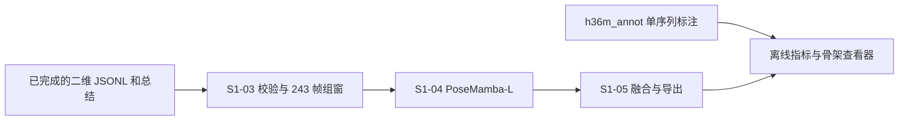

# S1-04：PoseMamba 三维时序提升详细设计

设计日期：2026-10-10。实施范围：243 帧 PoseMamba-L 推理、基准末端窗口、单序列完整滑窗，以及与 S1-05 的文件接口。保持 S1-03、S1-04、S1-05 为独立模块。

## 1. 已确认的约束

- S1-02 当前正式输入来源为 `rtmpose_l_h36m`，H36M17 关节顺序不变。
- 每次模型输入为 `float32[1,243,17,2]`；不输入置信度，不训练、不更换成 81 帧模型。
- 图片按原始帧号递增，可以跳帧；保存真实时间戳，不强制 50 FPS，不补帧、不重采样。
- `baseline` 只推理截止时刻之前最后 243 帧；`full` 在同一动作、同一相机内按 81 个输入样本的步长推理，最后一个窗口对齐序列末端。
- 全流程验收只使用 S9 `Directions_1.54138969` 的 472 张图片和已有二维结果。标注来自 `datasets/h36m_annot/h36m/annot/valid.h5` 及 `valid_images.txt`，不跑完整 S1。

旧总方案的 81 帧 baseline 和严格 50 FPS 约束不适用于本次实现，以本设计及用户最新决定为准。

## 2. 模块职责

S1-03 负责验证、归一化和组窗。S1-04 只负责加载官方网络和权重、执行推理及绑定输入元数据。S1-05 负责融合、可选平滑、截取观测和导出。H36M 标注读取和评价在推理之后执行，禁止把三维 GT 或基于预测拟合的尺度送入网络。



## 3. 固定官方模型

源码固定为 [PoseMamba df38d599212c058259f473464baec66d6a6487e0](https://github.com/nankingjing/PoseMamba/tree/df38d599212c058259f473464baec66d6a6487e0)。模型配置来自 [PoseMamba_train_h36m_L.yaml](https://github.com/nankingjing/PoseMamba/blob/df38d599212c058259f473464baec66d6a6487e0/configs/pose3d/PoseMamba_train_h36m_L.yaml)：时间长度 243，17 关节，二维通道 2，特征维度 128，深度 20，MLP 比例 2。

权重来自作者 [nankingjings/PoseMamba-weights](https://huggingface.co/nankingjings/PoseMamba-weights/blob/main/PoseMamba_L.bin)，固定下载版本 `732bd6d262b628cf2daf979bbd660a7d0974631a`，预期 SHA256 为 `031a033dbb4266f093d048e55758e55025c663f65db8d84291b6116794124501`。加载前验证 SHA；仅去掉 DataParallel 的 `module.` 前缀，使用 `strict=True`，不忽略缺失参数。

保存上游 Apache-2.0 许可证、来源及兼容改动记录。无需引入训练、检测器、整套上游依赖或更改已有 RTMPose 环境。

## 4. 本地运行兼容

本机是 Windows、PyTorch 2.1.2+cu118、6 GB CUDA GPU，未安装官方 selective-scan CUDA 扩展。实现保留官方 L 网络参数结构、四向扫描、位置/肢体特征叠加、归一化和输出 head；将选择性扫描底层运算提供为可审计的纯 PyTorch 推理实现。

状态递推为 `h[t] = exp(delta[t] * A) * h[t-1] + delta[t] * B[t] * u[t]`，输出为 `sum(C[t] * h[t]) + D * u[t]`。采用分块的仿射前缀合成减少逐时间点的 Python/CUDA 调用，避免直接除以长序列累计乘积导致下溢。测试与独立串行递推对照，涵盖不同扫描组、状态维度、非整块长度和强衰减；数值容差与后端名称写入运行记录。

这属于运行后端兼容，不代表已与官方编译 CUDA 核逐输出验收，也不能引用论文速度作为本机速度。后续如接入编译核，应另做数值与性能对照。

## 5. 输入与输出接口

外部接口 `PoseMambaBackend.predict(window: Pose2DWindow) -> Pose3DWindow`。加载模型一次，每个窗口顺序推理，默认 batch=1、FP32、`eval()`、`inference_mode()`，禁止自动回落到随机模型。

输入检查：形状、浮点类型、有限值、H36M17、归一化编号、identity 映射以及 243 帧元数据一致。只将 `keypoints_norm` 传入模型，帧号、真实时间戳、置信度和有效性掩码旁路保留。

输出包括：

- `pose_3d`：CPU 连续数组，`float32[243,17,3]`。
- 原始 `Pose2DWindow` 元数据，用于帧对齐和质量追踪。
- 模型名称、权重 SHA、源码版本、推理设备、后端、耗时和翻转设置。
- 坐标约定 `root_relative_image_3d`，单位 `h36m_image_normalized`。

模型训练输出是图像三维坐标的归一化结果，**不是直接的相机毫米坐标**。参见官方 [read_3d/denormalize](https://github.com/nankingjing/PoseMamba/blob/df38d599212c058259f473464baec66d6a6487e0/lib/data/datareader_h36m.py) 和 [evaluate 的 2.5d_factor](https://github.com/nankingjing/PoseMamba/blob/df38d599212c058259f473464baec66d6a6487e0/train.py)。不能使用一个未经核验的常数把所有结果标记为米或毫米。

## 6. 翻转与根关节

默认开启官方翻转测试。翻转输入时 x 取反，交换左集合 `[4,5,6,11,12,13]` 与右集合 `[1,2,3,14,15,16]`；翻转输出回原方向后取两次预测均值。关节 0 按官方 rootrel 评测置零；其余关节已按根相对目标训练，不额外减去预测根关节噪声。

翻转两次顺序执行，限制峰值显存。配置可关闭，结果必须标明，不与开启翻转结果混为同一实验。

## 7. 单序列完整模式

提供 S1-03 的离线组窗接口，复用既有帧验证、归一化、缓冲区和终止总结校验，不重新实现关节规则。先确认二维 JSONL 与成功总结匹配，再执行三维推理。对长度 N：

1. N<243 返回 `insufficient_frames`。
2. baseline 起点为 N−243，只有一个窗口。
3. full 起点为 `0,81,162,...`，起点必须不超过 N−243；尾部起点 N−243 不在列表时追加。
4. 不对最后不足一个窗口的部分补零或重复帧。

472 帧的 full 窗口为 `1–243、82–324、163–405、230–472`。跳帧序列中的步长表示样本数；源帧号和时间戳始终保持原值。

## 8. 配置与运行入口

新增 `configs/pose3d.yaml`，集中设置权重路径及 SHA、设备、翻转、运行模式、243/81 窗口、10 帧观测、平滑和标注路径。相对路径按配置目录解析。

用户入口是 `tools/run_pose3d.ps1`，读取已有二维 JSONL 和总结，通过 `--mode baseline/full` 或包装脚本参数切换。输出到新的实验目录，已有目录拒绝覆盖。可以提供源图片目录和单序列标注选择，生成离线查看器；推理本身不依赖标注。

结果至少包含：配置快照、模型/输入来源、三维 NPZ、运行总结、逐帧/逐关节 CSV、指标 JSON 和可用浏览器打开的骨架查看器。提供单序列比较脚本，比较 baseline/full 及可选平滑时按相同帧集合计算指标。

## 9. 异常与运行记录

权重缺失、SHA 不符、参数不匹配、CUDA 不可用、显存不足、输入不完整、模型输出 NaN、跨序列窗口、标注不匹配都必须返回明确错误与非零退出码。失败可保留诊断文件，但不能输出成功总结或完整阶段输出。OOM 提示 batch=1 和显存状态，不静默降分辨率、不切换小模型。

GPU 初始化时间、每窗口推理时间、窗口数、处理帧数和 CUDA 峰值显存与精度指标分开记录。稀疏 10 FPS 的单动作验收不能当作官方 H36M 全测试集复现。

## 10. 验收

单元验证覆盖严格权重匹配、独立递推数值、翻转往返、形状/有限值、baseline/full 帧覆盖、尾窗对齐、源帧号保留以及失败状态。真实 GPU 验收只运行同一个 S9 动作序列，并核实实际加载权重、输出 `[L,17,3]`、关节 0 为零及全部元数据对应。

从用户角度：运行包装脚本，打开输出 `viewer.html` 播放/拖动帧并旋转骨架；核对动作、左右肢体、根相对坐标和末 10 帧；再查看 `metrics.json`、逐帧 CSV 和比较 CSV。具体命令、指标含义及评价限制见 [S1-05 详细设计](S1-05_三维序列融合与输出详细设计.md)。

## 11. 开发完成与实际验收

2026-10-10 已实现并完成本机验收。实际入口为 `video_to_3d_motion.pose3d.cli`，核心网络接口在 `src/video_to_3d_motion/pose3d/backend.py`；离线组窗复用 `pose_adapter/windows.py` 与 `WindowBuffer.make_window()`。本次实现通过二维 JSONL 文件连接阶段，未把两个 GPU 模型放入同一在线线程队列。CPU 导出模块位于 `stage_output`，与三维后端分开。

实际官方 checkpoint 包含 772 个参数/缓冲条目，`module.` 前缀去除后严格匹配；当前源码与这份权重对应的参数总数实测为 9,450,499，运行总结记录实测数，不沿用论文简介中的参数量。

真实 GPU 使用 CUDA:0、FP32、翻转测试开启：末端 baseline 一次推理约 7.88 秒；full 四个窗口的模型推理合计约 30.76 秒，均输出有限数值，峰值分配显存约 225 MiB。这些是本机兼容后端实测，不是官方编译核性能。

验收目录为 `results/s1_04_05_acceptance_2026-10-10/`：`s9_baseline`、`s9_full`、`s9_full_ema`。full 覆盖 472 个输入样本，baseline 覆盖目标帧 230–472；源帧号与真实时间戳逐值核对不变。保存窗口独立按帧求均值，与最终未平滑数组完全一致；P_obs 与最终输出末 10 帧完全一致。

全项目 84 项回归测试通过，依赖兼容检查通过。三个查看器在真实 Edge 无头浏览器完成渲染、实际鼠标旋转、滚轮缩放、播放、拖帧、GT 开关和重播测试，截图及机器可读结果保存在验收目录。

额外用真实 S9 输入、第一层已经学习的扫描参数，在四个方向各抽取 4 个通道，覆盖完整 4131 个扫描位置及 16 个状态，逐值对比独立 NumPy float64 串行递推。最大绝对误差为 `7.86e-6`、RMSE 为 `1.55e-6`，通过 `atol=rtol=2e-5` 验收；证据在 `scan_real_input_verification.json`。该检查验证递推兼容实现，不代替与上游编译 CUDA 核的直接对照。

默认完整单序列验证：

```powershell
cd D:\Paper\video-to-3d-motion
.\tools\run_pose3d_demo.ps1 -Mode full
```

此入口只读取已有 S9 `Directions_1.54138969` 的二维结果，不重新检测所有图片、不遍历整套 S1。输出目录自动带时间标识。若在其他机器缺少依赖/权重，先运行 `tools/setup_posemamba.ps1`；前提是已有项目的 Torch GPU 环境，脚本不替换现有 Torch/CUDA。

已有任意 H36M17 二维结果可以用 `tools/run_pose3d.ps1 -InputPath ... -InputSummary ... -OutputDir ... -Mode full`，或 `lift-pose3d` 命令。无标注也能导出三维数组和归一化骨架查看器；源图片可独立使用 `-ImageDir`、`-ImagePrefix` 指定。评价时同时给出 `-Annotations`、`-AnnotationNames`、`-Sequence`。
